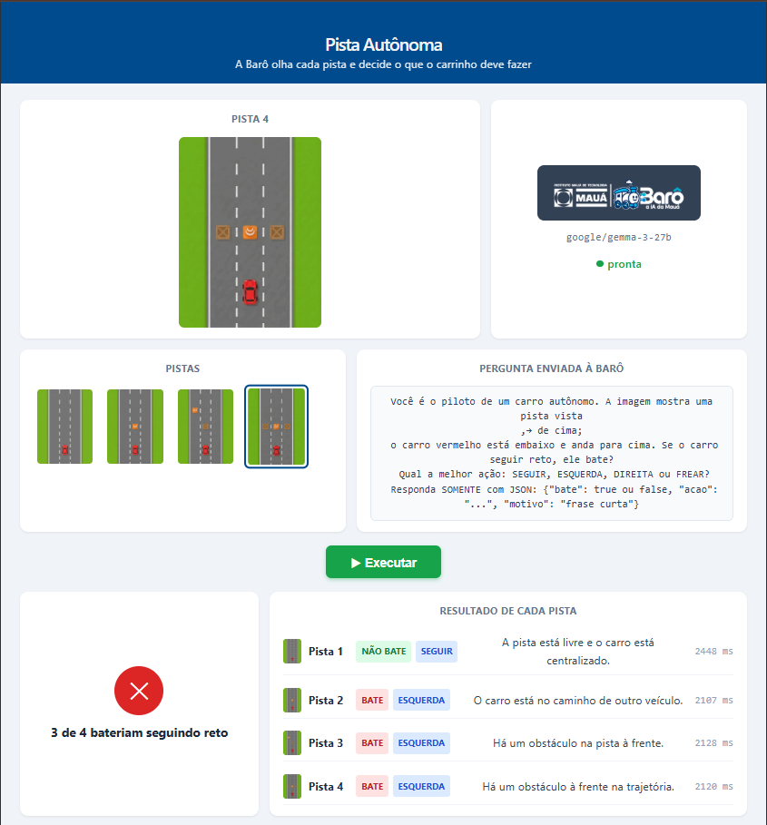

# 🚗 Pista Autônoma com a Barô

Aplicação React de página única (SPA) desenvolvida para simular a tomada de decisão de um veículo autônomo utilizando o modelo multimodal **`google/gemma-3-27b`** através da API da **Barô** (IA do Instituto Mauá de Tecnologia). 

Ao clicar em **Executar**, cada imagem de pista (vista de cima) é convertida em Base64 e enviada via `axios` para a Barô, que analisa a cena e retorna em formato JSON se o carrinho bateria seguindo reto (`bate`), qual manobra deve realizar (`SEGUIR`, `ESQUERDA`, `DIREITA` ou `FREAR`) e o motivo da decisão.

---

## 👥 Equipe
- **Kauã Ferraresi Lima** **RA: 24.10090-1**
- **Ian Akel** **RA: 24.10058-8**
- **Ewerton da Cruz** **RA: 24.10113-1**
- **Thiago Monteiro** **RA: 24.10070-3**


---

## 🚀 Como rodar o projeto

### Pré-requisitos
- **Node.js** (versão 20.19 ou superior)
- Chave de acesso da API da Barô fornecida pelo professor

### Passo a passo

1. **Clone o repositório e acesse a pasta do projeto:**
   ```bash
   git clone https://github.com/SEU-USUARIO/pista-autonoma.git
   cd pista-autonoma
   ```

2. **Instale as dependências:**
   ```bash
   npm install
   ```

3. **Configure as variáveis de ambiente:**
   Crie um arquivo chamado `.env` na raiz do projeto (ao lado do `package.json`) com o seguinte conteúdo:
   ```env
   VITE_BARO_URL=/api-baro
   VITE_BARO_KEY=cole-sua-chave-aqui
   VITE_BARO_MODEL=google/gemma-3-27b
   ```
   *(Observação: o arquivo `vite.config.js` está configurado com proxy redirecionando `/api-baro` para a API da Barô em `https://ia.maua.br/api/v1` para evitar bloqueios de CORS no navegador).*

4. **Inicie o servidor de desenvolvimento:**
   ```bash
   npm run dev
   ```

5. **Acesse no navegador:**
   Abra `http://localhost:5173` e clique em **▶ Executar**.

---

## 🖥️ Print da Tela



---

## 🧠 Análise do Comportamento da IA (Acertos e Erros)

Durante os testes realizados com as quatro cenas geradas (com tempo médio de resposta entre `2130 ms` e `2380 ms` por pista), a Barô (`google/gemma-3-27b`) acertou 100% da detecção de colisão frontal (`bate: false` na Pista 1, que estava livre, e `bate: true` nas Pistas 2, 3 e 4, que possuíam obstáculos na faixa central). Quanto à escolha da manobra, a IA **acertou** nas **Pistas 1 e 2**, decidindo `SEGUIR` na pista livre e desviar para a `ESQUERDA` quando havia apenas um cone bloqueando a faixa do meio. Por outro lado, o modelo **errou** a tomada de decisão nas **Pistas 3 e 4**, recomendando virar para a `ESQUERDA` mesmo quando a faixa da esquerda também continha um obstáculo mais à frente (Pista 3, onde a única faixa livre era a `DIREITA`) e quando todas as três faixas estavam totalmente bloqueadas (Pista 4, onde a única ação segura seria `FREAR`), demonstrando que o modelo foca bem no obstáculo imediatamente à frente do capô do carro, mas apresenta dificuldade espacial para verificar se as faixas laterais de destino estão realmente desimpedidas.
